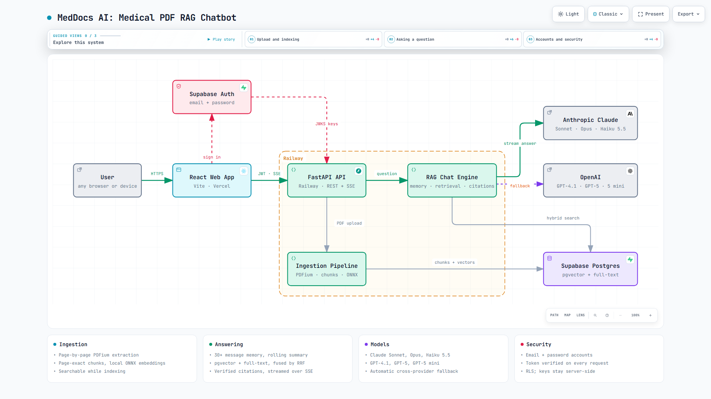

# MedDocs AI: Medical PDF RAG Chatbot

Upload multiple medical PDFs and ask questions about them. Claude (or OpenAI as a fallback) answers **only** from the uploaded documents, with verifiable citations (document name and page). When the documents do not cover a question, the assistant says so politely instead of guessing.

> This tool is not a substitute for professional medical advice, diagnosis or treatment.

Author: **Usama Navid**

**Live app:** https://pdf-rag-chatbot-zeta-nine.vercel.app (create an account with email and password)

## Architecture



For the interactive version, open **[architecture.html](architecture.html)** in a browser (download it, then double-click). It has guided views for the three main flows (upload and indexing, asking a question, accounts and security), pan and zoom, light and dark themes, a presentation mode and exports. The diagram source is [docs/architecture.archify.json](docs/architecture.archify.json). [docs/architecture.md](docs/architecture.md) explains the full design: data flow, citation flow, conversation memory, security and failure handling.

**In one paragraph:** the React app (Vercel) signs the user in with Supabase Auth and talks to a FastAPI backend (Railway) using the user's token. Uploaded PDFs are extracted page by page with PDFium, split into page-exact chunks, embedded locally with an ONNX model, and stored in Supabase Postgres with pgvector and full-text indexes. A question is answered by searching the user's own passages with hybrid (vector + keyword) retrieval, then streaming a Claude answer whose citations are checked against the retrieved passages. OpenAI takes over automatically if Claude is unavailable.

## Stack

- **Frontend:** React 18 + Vite + TypeScript (`frontend/`), deployed on Vercel
- **Backend:** Python 3.12 FastAPI (`backend/`), Docker on Railway
- **Database and vectors:** Supabase Postgres + pgvector, with hybrid vector and full-text retrieval (`supabase/migrations/`)
- **LLM:** Anthropic Messages API (Claude Sonnet 5.5, Opus 5.5, Haiku 5.5) and OpenAI Chat Completions (GPT-4.1, GPT-5, GPT-5 mini), streaming, server-side keys only
- **Embeddings:** local ONNX `BAAI/bge-small-en-v1.5` via fastembed (no extra API key)
- **PDF extraction:** PDFium (`pypdfium2`), with `pypdf` as a fallback

## Features

- Multi-file PDF upload (button or drag and drop) with a live indexing progress bar per document
- Documents become searchable while they are still indexing, so a 1,000-page book can be asked about within seconds
- Page-level text extraction, with chunks that never span pages, so every citation points to one exact page
- Handling of invalid, empty, corrupted, password-protected, image-only and non-PDF files, and automatic failure of jobs interrupted by a server restart
- SHA-256 dedup, so re-uploading a file never re-embeds it
- Hybrid retrieval (pgvector HNSW + Postgres full-text search, fused with Reciprocal Rank Fusion) in a single SQL call
- Streaming Markdown answers over Server-Sent Events (SSE), with numbered citations and source chips that open the exact excerpt used
- Citations derived only from retrieved chunks; unknown labels are stripped
- Conversational replies: greetings, "what documents do you have?", out-of-scope questions and still-indexing documents all get gentle, accurate answers instead of a canned refusal
- Chat history: conversations are saved, grouped by date, and can be renamed or deleted
- Long-conversation memory: the model sees at least the last 30 messages word for word, and older messages are automatically compacted into a running summary in the background, so a chat can continue for hundreds of messages without slowing down or forgetting
- Topic switches and follow-ups both work: each question is searched on its own and together with the previous question, in parallel
- Accounts: email and password sign-up and sign-in (Supabase Auth). Documents and chats belong to the account and are available on any device; data created in a browser before accounts existed is moved into the account on first sign-in
- Collapsible sidebars: hide or show chat history and the library from the top bar (remembered per browser)
- Model picker with 3 models per provider and a live status badge per provider (Active, Ready, Not set up, or the reason it last failed)
- Automatic AI fallback: if the chosen model fails (no credits, bad key, rate limit, outage), the other provider answers, and a failure partway through an answer restarts cleanly. If both fail, the user sees a plain-language reason for each
- Stop generation, copy answer with citations, and a responsive layout (history and library become slide-over panels on small screens)

## Project layout

```
backend/                 FastAPI service (Railway)
  app/main.py            HTTP endpoints: documents, chat (SSE), conversations, models, account claim
  app/auth.py            Supabase Auth token verification (ES256 via JWKS)
  app/pdf.py             PDF validation, page-level extraction (PDFium), page-bounded chunking
  app/embeddings.py      Local ONNX embeddings (bge-small, 384 dimensions)
  app/llm.py             Model catalog, prompt, Claude/OpenAI streaming with fallback, citations
  app/memory.py          Conversation window and rolling summary
  app/db.py              Supabase PostgREST client (service role, server-side only)
  tests/                 58 automated tests
frontend/                React + Vite + TypeScript app (Vercel)
  src/main.tsx           App shell: history, chat, library, streaming, panels
  src/AuthScreen.tsx     Sign up / sign in
  src/ui.tsx             Logo, icons, Markdown answers with citations, model picker
supabase/migrations/     SQL to run in the Supabase SQL Editor, in order
docs/                    Architecture notes, diagram source and preview image
architecture.html        Interactive architecture diagram
```

## Prerequisites

- Python 3.12 and Node.js 20 or newer
- A Supabase project
- An Anthropic API key, an OpenAI API key, or both (with both, each one is the automatic fallback for the other)

## Setup

### 1. Supabase
In the Supabase dashboard, open the SQL Editor and run the migrations in order:
1. [supabase/migrations/0001_init.sql](supabase/migrations/0001_init.sql): tables, the pgvector HNSW and full-text GIN indexes, Row Level Security (RLS) and the `match_chunks` function.
2. [supabase/migrations/0002_conversations_progress.sql](supabase/migrations/0002_conversations_progress.sql): chat history, indexing progress, document previews, and search while indexing.
3. [supabase/migrations/0003_conversation_memory.sql](supabase/migrations/0003_conversation_memory.sql): the rolling conversation summary. Until it is applied, chats still work with the 30+ message window, without summaries.

Every migration is safe to run more than once.

Then configure **Authentication**:
- **Sign In / Providers → Email:** keep Email enabled. For instant sign-up, turn **Confirm email** off. If you keep it on, new users must click the emailed link before signing in, and Supabase's built-in email sender only allows a few emails per hour, so add your own SMTP under Authentication → Emails for real use.
- **URL Configuration → Site URL:** set it to your Vercel URL, so confirmation links open the app.

### 2. Backend
```bash
cd backend
python -m venv .venv
.venv/Scripts/activate        # Windows; on macOS/Linux: source .venv/bin/activate
pip install -r requirements-dev.txt
cp .env.example .env          # fill in the AI key(s), SUPABASE_URL, SUPABASE_SERVICE_ROLE_KEY
uvicorn app.main:app --port 8000
```
On the first start the backend downloads the embedding model (about 70 MB, once). `GET http://localhost:8000/health` returns `{"status":"ok"}` when it is ready.

### 3. Frontend
```bash
cd frontend
npm install
cp .env.example .env.local    # VITE_API_URL, VITE_SUPABASE_URL, VITE_SUPABASE_ANON_KEY
npm run dev                   # http://localhost:5173
```
Open http://localhost:5173, create an account, upload a PDF and ask a question. Keep `ALLOWED_ORIGINS=http://localhost:5173` in the backend `.env` for local development.

## Environment variables

| Variable | Where | Purpose |
|---|---|---|
| `ANTHROPIC_API_KEY` | backend | Claude API key (server-side only) |
| `ANTHROPIC_MODEL` | backend | Default Claude model: `claude-sonnet-5-5` (or `claude-opus-5-5`, `claude-haiku-5-5`) |
| `OPENAI_API_KEY` | backend | OpenAI key (server-side only); enables the OpenAI models and the fallback |
| `OPENAI_MODEL` | backend | Default OpenAI model: `gpt-4.1` (or `gpt-5`, `gpt-5-mini`) |
| `LLM_PRIMARY` | backend | Provider selected by default: `anthropic` (default) or `openai` |
| `LLM_TIMEOUT_S`, `LLM_MAX_RETRIES` | backend | Per-request AI timeout (default 60 s) and retries (default 2) |
| `HISTORY_WINDOW`, `HISTORY_COMPACT_AT` | backend | Messages always sent verbatim (default 30), and the unsummarised count that triggers compaction (default 50) |
| `SUPABASE_URL` | backend | `https://<ref>.supabase.co` |
| `SUPABASE_SERVICE_ROLE_KEY` | backend | Server-side only; never ship it to the browser |
| `ALLOWED_ORIGINS` | backend | Comma-separated CORS origins, e.g. your Vercel URL |
| `TOP_K`, `MIN_SIMILARITY`, `MAX_UPLOAD_MB` | backend | Retrieval and upload tuning |
| `VITE_API_URL` | frontend | Public backend URL |
| `VITE_SUPABASE_URL`, `VITE_SUPABASE_ANON_KEY` | frontend | Used only to sign in. The anon key is public by design: RLS gives it no data access |

## Testing

```bash
cd backend && python -m pytest -q    # 58 tests, no network or API keys needed
cd frontend && npm run build         # type-check + production build
```
The tests use an in-memory stand-in for the database and scripted AI responses, so they run offline. They cover:
- PDF extraction with page numbers
- Invalid, corrupted and empty PDFs
- Page-bounded chunking
- Citation mapping and stripping of fabricated labels
- Prompt construction
- File-type rejection
- The database-outage 503 path (without leaking internal details)
- Gentle replies with no LLM call when there are no documents or indexing has only just started
- Partly indexed documents being answerable, and stuck jobs being marked failed
- Meta questions ("what context do you have?") reaching the model with the document library
- Chat history: saving, follow-ups with context, listing, renaming, deleting, and isolation between workspaces
- Model selection, unknown-model fallback, and the 3-per-provider model catalog with status
- AI fallback in both directions, mid-answer failure reset, and plain-language messages when both providers fail
- Authentication: every data endpoint refuses missing and invalid tokens; ES256 tokens are rejected when expired, tampered, or issued for another audience or issuer; old browser data is claimed into the account, and another account's data can never be claimed
- Conversation memory: 30+ message window, history always starting on a user turn, old citations rendered as document and page, compaction folding exactly what is older than the window, summariser failure losing nothing, and a topic switch after a long thread still retrieving the new topic's passages

## Deployment

**Backend (Railway):** create a service from this GitHub repo. In the service settings set the root directory to `/backend`, the Dockerfile path to `Dockerfile`, and the health check path to `/health`. Add the backend environment variables, including `PORT=8000`, then generate a public domain on port 8000. The Docker image bakes in the embedding model, so restarts do not download it again.

**Frontend (Vercel):** import the repo with root directory `frontend` (framework Vite, see `frontend/vercel.json`). The production values (`VITE_API_URL` and the public Supabase URL and anon key) are in `frontend/.env.production`; Vercel environment variables with the same names override them. Then add the Vercel URL to the backend's `ALLOWED_ORIGINS`, and to Supabase Auth's Site URL.

**Why the backend is not on Vercel:** Vercel functions limit request bodies to 4.5 MB and cannot keep a background indexing job alive. Medical PDFs and books are often larger, and indexing runs in the background, so the backend runs as a persistent container on Railway. See [docs/architecture.md](docs/architecture.md).

## Production hardening (not yet implemented)

- Password reset by email, and an optional second factor
- Store the original PDFs in Supabase Storage, so citations can open at the exact page
- Add an evaluation set for retrieval and answer quality (hit rate, citation precision, abstention accuracy)
- Faster indexing for very large books: more vCPUs on Railway, or a hosted embedding API (embedding runs at roughly 9 passages per second on the current instance)

## License

MIT, see [LICENSE](LICENSE).
